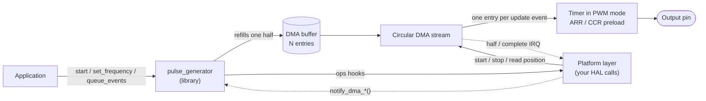

# stm32-pulse-generator

HAL-independent C library that generates exact pulse trains from a hardware
timer fed by circular DMA.

[](https://github.com/asansil/stm32-pulse-generator/actions/workflows/ci.yml)
[](LICENSE)
[](CMakeLists.txt)

The library drives an output pin (for example the STEP input of a stepper
motor driver) with a precise number of pulses, a frequency that can change
on the fly, or an arbitrary sequence of pulses at caller-chosen instants. It
never touches vendor headers: everything hardware-specific goes through a
small table of function pointers that the integrator implements, so the core
builds and is tested on a PC, and runs on any MCU whose timer and DMA can do
the job. The reference port and the three example projects target the
STM32F407 Discovery board.

<!-- TODO: add docs/images/fixed-count-1khz-x10.png: logic-analyzer capture of the fixed-count example, 1 kHz × 10 pulses, 100 µs fixed width, with the PD13 movement marker; period and width measurements visible, channels labeled STEP and MARK. -->

The previous, HAL-dependent version of the library is tagged
[`v1.0.0`](https://github.com/asansil/stm32-pulse-generator/tree/v1.0.0).

## Features

- **Three generation modes** on one engine:
  - **Fixed count**: exactly N pulses at a fixed frequency, then stops by
    itself.
  - **Continuous**: pulses at a frequency that can be changed while running,
    until stopped.
  - **Scheduled**: an arbitrary sequence of intervals streamed through a
    caller-owned queue, so a long movement never has to fit in memory.
- **Pulse shape**: 50 % duty (half period) or a fixed high time in ns,
  whatever the period.
- **No interrupt per edge**: the CPU cost goes per buffer entry, not per
  pulse, and the latency of every change is bounded by a configurable window.
- **Events**: `COMPLETE`, `LOW_WATERMARK` (time to queue more) and
  `UNDERRUN`, through one callback.
- **Multi-instance**: one statically allocated instance per output, no heap.
- **Portable**: C99, no vendor headers in the library; six platform hooks.
- **Optional utilities** (`pulse_generator_util.h`): µs/ns/Hz to ticks,
  an iterator that spreads n pulses over T ticks with no drift, and a
  timeline that turns absolute instants into intervals without accumulating
  rounding errors.
- **Tested on host**: 175 Unity test cases against a mock platform, run in
  CI on pushes and pull requests.

## How it works

Each output is one timer in PWM mode with its period (ARR) and compare (CCR)
registers preloaded. A circular DMA stream writes one *entry* (a period and
a compare value) into those preload registers at every update event, so the
timer plays the buffer on its own. The DMA interrupts at each half of the
buffer, and the library refills the half that has just played.



Two settings bound the behavior:

- **Window** (`window_us`). No entry lasts longer than `window_us / entries`;
  a longer period is split across several entries, which is invisible on the
  pin. Anything a refill writes, such as a new frequency or the next queued
  pulse, therefore reaches the pin within one window (for a frequency
  change, plus the rest of a period in progress that is longer than that).
- **Entries** (`entries`). More entries mean fewer interrupts per second at
  the same window. The refill rate never drops below `entries / window`
  entries per second, even at low frequencies, so a longer window trades
  latency for CPU.

## Requirements

**Target hardware**, per output:

- A timer with a PWM output and preloaded period and compare registers.
- A DMA request on the timer's update event that can write an entry into
  those registers in one burst (on STM32, `TIMx_DCR`/`TIMx_DMAR`).
- A circular DMA stream with half-transfer and transfer-complete interrupts,
  and a buffer in RAM the DMA can reach.

**Library**: a C99 compiler. No heap, no RTOS, no vendor headers.

**Host tests**: CMake 3.21+, Ninja and gcc. Unity v2.6.0 is fetched by CMake
on the first configure.

**Examples**: an STM32F407G-DISC1 board and STM32CubeCLT
(`arm-none-eabi-gcc`), or the STM32Cube extension for VS Code.

## Integration

1. **Add the sources.** Compile `src/pulse_generator.c` (and
   `src/pulse_generator_util.c` if you use the utilities) with `include/` on
   the include path, or add this repository with `add_subdirectory()` and
   link the `pulse_generator` target.
2. **Implement the platform hooks.** Fill one `pulse_generator_ops_t` for
   your MCU; every hook receives the per-output `hw` handle you pass in the
   configuration, so one const table serves every output.

   | Hook | Does |
   |---|---|
   | `get_tick_hz` | Report the timer's counter rate after the prescaler |
   | `get_period_max` | Report the largest value ARR/CCR accept |
   | `get_entry_layout` | Say where the period and compare words go in an entry |
   | `stream_start` | Start the circular DMA stream and the timer |
   | `stream_stop` | Stop at once with the pin low (also called from interrupts) |
   | `get_stream_remaining` | Report the stream's position (NDTR on STM32) |

   The STM32F4 HAL implementation in
   [`pulse_generator_platform.c`](examples/stm32f407_discovery_fixed_count/App/pulse_generator/pulse_generator_platform.c)
   is the reference; the contract of each hook is documented in
   [`pulse_generator.h`](include/pulse_generator.h).
3. **Forward the DMA interrupts.** Call
   `pulse_generator_notify_dma_half_complete()` and
   `pulse_generator_notify_dma_complete()` from the stream's half-transfer and
   transfer-complete interrupts.
4. **Hold the pin low at reset.** See [Limitations](#limitations).

## Usage

A fixed-count movement on the STM32F4 reference port (error checks omitted
for brevity; every function returns a `pulse_generator_status_t`):

```c
#include "pulse_generator.h"
#include "pulse_generator_platform.h" /* the STM32F4 ops table and hw handle */

#define PG_ENTRIES 32U

extern TIM_HandleTypeDef htim4; /* generated by STM32CubeMX */

static pulse_generator_t pg;
static stm32f4_pg_hw_t   pg_hw;
/* Entries x the largest entry the port uses (6 words); must be DMA-reachable
   (on the F4, SRAM rather than CCM RAM). */
static uint32_t pg_buffer[PG_ENTRIES * 6U];

static void on_event(pulse_generator_t *instance, pulse_generator_event_t event, void *ctx)
{
    (void)instance;
    (void)ctx;
    if (event == PULSE_GENERATOR_EVENT_COMPLETE) {
        /* Last pulse emitted. Runs in interrupt context: keep it short. */
    }
}

void app_init(void)
{
    stm32f4_pg_hw_init(&pg_hw, &htim4, TIM_CHANNEL_1);

    pulse_generator_init(&pg, &(pulse_generator_config_t){
        .ops      = &g_stm32f4_pg_ops,
        .hw       = &pg_hw,
        .on_event = on_event,
        .dma = {
            .buffer       = pg_buffer,
            .buffer_words = sizeof pg_buffer / sizeof pg_buffer[0],
            .entries      = PG_ENTRIES,
            .window_us    = 2000U, /* changes reach the pin within 2 ms */
            .min_entry_ns = 500U,  /* shortest entry the DMA burst can keep up with */
        },
    });

    pulse_generator_start_fixed_count(&pg, 1000U, 10U); /* 10 pulses at 1 kHz */
}

/* HAL reports the update DMA stream's interrupts as these callbacks. */
void HAL_TIM_PeriodElapsedHalfCpltCallback(TIM_HandleTypeDef *htim)
{
    if (htim->Instance == TIM4) {
        pulse_generator_notify_dma_half_complete(&pg);
    }
}

void HAL_TIM_PeriodElapsedCallback(TIM_HandleTypeDef *htim)
{
    if (htim->Instance == TIM4) {
        pulse_generator_notify_dma_complete(&pg);
    }
}
```

The other modes follow the same pattern:

| Mode | Start | While running | Ends |
|---|---|---|---|
| Fixed count | `start_fixed_count(pg, hz, count)` | `get_pulse_count()` | By itself, reporting `COMPLETE` |
| Continuous | `start_continuous(pg, hz)` | `set_frequency(pg, hz)` | `stop()` |
| Scheduled | `prepare_scheduled(pg, &cfg)`, `queue_events(pg, intervals, n)`, `start_scheduled(pg)` | `queue_events()`, prompted by `LOW_WATERMARK` | `finish_scheduled()` then `COMPLETE`; a queue that runs dry ends in `UNDERRUN` |

All names carry the `pulse_generator_` prefix. Scheduled intervals are in
timer ticks; the utilities convert from µs, ns or Hz. The pulse shape is set
in the configuration or, while idle, with `pulse_generator_set_pulse_shape()`.

## Examples

One self-contained STM32CubeMX/CMake project per mode, for the STM32F407
Discovery. All use TIM4 CH1 on PD12 (also LED LD4) with DMA1 Stream 6, 32
entries and a 2 ms window; PD13 (LD3) marks each movement for a logic
analyzer.

| Example | Demonstrates |
|---|---|
| [`stm32f407_discovery_fixed_count`](examples/stm32f407_discovery_fixed_count) | 1 kHz × 10, 25 kHz × 1000 and 20 Hz × 10 (each period split across 800 entries), with half-period and fixed-width pulses |
| [`stm32f407_discovery_continuous`](examples/stm32f407_discovery_continuous) | A frequency cycle 1 → 5 → 25 kHz → 20 Hz, changed on the fly every 2025 ms |
| [`stm32f407_discovery_scheduled_dma`](examples/stm32f407_discovery_scheduled_dma) | A short sequence, an acceleration ramp to a 5 kHz cruise, a queue left to run dry, and latency markers |

In each project, `Core/` and the `.ioc` belong to STM32CubeMX (hand edits only
inside `USER CODE` blocks) and `App/pulse_generator/` holds the integration:
the platform hooks and the application. Open the folder with the STM32Cube
extension, or build from a shell with STM32CubeCLT on the `PATH`:

```sh
cd examples/stm32f407_discovery_fixed_count
cmake --preset Release
cmake --build --preset Release
```

Flash `build/Release/stm32f407_discovery_fixed_count.elf` with the extension or
STM32CubeProgrammer.

## Measured on hardware

STM32F407 Discovery at 168 MHz, timer tick 84 MHz, 32 entries, 2 ms window,
24 MHz logic analyzer; the three examples above, Debug builds unless noted.

**Waveform.** Exact pulse counts, periods and high times in every case of
the fixed-count example, including periods split across up to 800 entries
and a 100 µs fixed-width pulse spread over two entries. `COMPLETE` is
reported within one window after the last period.

**Frequency changes** (continuous example), from the call to the new period
on the pin:

| Change | Measured | Bound |
|---|---|---|
| 1 → 5 kHz | 1.209 ms | window + rest of a 1 ms period |
| 5 → 25 kHz | 1.009 ms | window + rest of a 200 µs period |
| 25 kHz → 20 Hz | 0.976 ms | window |
| 20 Hz → 1 kHz | 25.975 ms | window + rest of a 50 ms period |

**CPU cost** (scheduled example):

| | Release (`-Os`) | Debug (`-O0`) |
|---|---|---|
| Refill, per entry | ~145 cycles (0.86 µs) | ~590 cycles |
| CPU load across the example's movements | 1.1–1.7 % | 4.6–7.2 % |
| Longest interrupt | 14 µs | ~56 µs |
| Start of a movement | ~26 µs | ~100 µs |
| Highest sustained rate, one entry per period | 750 kHz (1 MHz fails) | 200 kHz (300 kHz fails) |

The load never drops below the refill floor: 16 000 entries/s with this
configuration, about 1.4 % in Release even with almost no pulses.

**Footprint** (GCC 14.3, `-Os`, Cortex-M4): ~2.3 KB of flash for the
library, ~0.5 KB for the utilities, 192 bytes of RAM per instance plus the
caller's DMA buffer (`entries × words per entry × 4`: 384 bytes for 32 entries
on channel 1).

## Limitations

- **Sustained rate.** Every entry costs a refill, so with one entry per
  period the rate is capped by the refill time: above ~750 kHz on the F407 in
  Release, a refill lands late and the movement stops with `UNDERRUN`. Only
  movements that fit in the initial fill (one buffer of entries) are safe
  beyond that.
- **Shortest entry.** The DMA burst must land before the next update event;
  `min_entry_ns` sets that floor. On the F407 bursts start repeating at
  250 ns entries, so the examples use 500 ns, which caps the frequency at
  2 MHz.
- **Bounded, not zero, latency.** Changes take effect within one window, and
  the end of a movement is reported up to one window after its last period.
- **One timer and one DMA stream per output**, driven by the timer's update
  DMA request.
- **Validated on STM32F407 only.** The reference platform layer uses the
  STM32F4 HAL; other MCUs need their own `pulse_generator_ops_t`.
- **Output level at reset.** Between movements the library keeps the pin
  low, but during reset and early boot the pin floats until the timer is
  initialized. A STEP line needs an external pull-down; see
  [STEP line idle level](docs/notes/step-line-idle-level.md).
- **Event callback in interrupt context.** It runs inside the
  `notify_dma_*()` calls; the header lists the few functions it may call.

## Building and running the tests

No cross toolchain is needed. With CMake 3.21+, Ninja and gcc, the `dev`
preset is the same one CI runs:

```sh
cmake --preset dev
cmake --build build
ctest --test-dir build --output-on-failure
```

Without the preset, configure with
`cmake -S . -B build -DPULSE_GENERATOR_BUILD_TESTS=ON`. CI also builds with
warnings as errors.

## Repository layout

| Path | Contents |
|---|---|
| [`include/`](include) | Public API: `pulse_generator.h`, `pulse_generator_util.h` |
| [`src/`](src) | Implementation |
| [`tests/`](tests) | Host unit tests (Unity + CTest) and the mock platform |
| [`examples/`](examples) | STM32F407 Discovery firmware projects, one per mode |
| [`docs/`](docs) | Bench notes and the frequency/resolution spreadsheet |

## Documentation

- [`pulse_generator.h`](include/pulse_generator.h): the authoritative
  contract: every function, hook, event and configuration field, documented
  in Doxygen comments.
- [`pulse_generator_util.h`](include/pulse_generator_util.h): the optional
  utilities.
- [STEP line idle level](docs/notes/step-line-idle-level.md): bench notes on
  the output level at reset and between movements.
- [`PulseGen.xlsx`](docs/PulseGen.xlsx): frequency and resolution
  spreadsheet.

## License

[MIT](LICENSE).
